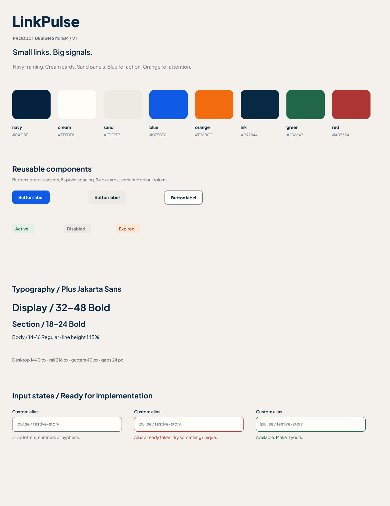

# LinkPulse Frontend Redesign — Agent Execution Brief

Use this file as the implementation brief for an AI coding agent working in this repository. The goal is to bring the existing LinkPulse product UI into the visual language of the supplied Figma design while preserving the real app and its existing workflows.

## Design source and available references

- Figma file: [LinkPulse — Product Design](https://www.figma.com/design/KBrKYr6s84ZDaEG3ClHUF6/LinkPulse-%E2%80%94-Product-Design?node-id=0-1&p=f&t=4BXYRjExMywaEMBk-0)
- File key: `KBrKYr6s84ZDaEG3ClHUF6`
- Available design frame: `9:632`, `Foundations / Tokens and components`
- Figma page: `00 / Foundations`
- A local PNG export of that actual frame is embedded below and stored at `docs/design/assets/figma-foundations.png`.

**Reference boundary:** the supplied Figma file currently contains a foundations board rather than dashboard, links, analytics, campaign, QR, import, or admin screen mockups. Its asset export has no raw uploaded images and no separate SVG illustration assets. Use the screenshot above and the palette/type/component guidance below as the authoritative visual reference. Do not invent a claim that an unseen screen is pixel-perfect to Figma or imply that a made-up illustration came from the design file. If additional screen frames are later added to Figma, inspect those frames and follow them before inventing page layouts.

## Objective

Redesign the existing frontend as a coherent, polished LinkPulse product. Translate the warm, editorial, confident foundations into a practical analytics/link-management interface. Prioritize legibility, strong hierarchy, calm surfaces, useful data density, and clear action affordances. Make the UI feel intentional across every route, not like a reskinned template.

## First inspect the working product

Before editing, inspect the current repository, `README.md`, `docs/PROGRESS.md`, `docs/final/API.md`, `server/prisma/schema.prisma`, routes, shared shell, styles, and page components. Run the app using the documented workflow if the local database and environment are available. Trace the current component and API behavior before replacing any layout. Preserve existing copy and real product data; do not add fabricated metrics, customer logos, testimonials, link destinations, or claims.

The project is a React 19 + TypeScript + Vite frontend with Tailwind CSS, React Router, TanStack Query, Recharts, and Lucide icons. The current product routes include login, signup, dashboard, links/create-link wizard, campaigns/detail, analytics, QR codes, CSV import, admin, public link status, and password unlock. The authenticated shell is `web/src/components/layout/Shell.tsx`; shared styles/tokens are primarily in `web/src/index.css` and `web/tailwind.config.js`.

## Figma foundations to implement

### Color tokens

Replace conflicting old palette values. Define reusable CSS variables and map Tailwind semantic colors to them so page components do not each invent colors.

| Token | Hex | Intended use |
|---|---|---|
| Canvas | `#F4F1EC` | Warm overall app background |
| Navy | `#04213F` | Strong navigation framing / deep surfaces |
| Cream | `#FFFDF8` | Cards, forms, inputs, elevated light surfaces |
| Sand | `#EDE9E3` | Secondary surfaces, quiet controls, dividers |
| Blue | `#0F5BE6` | Primary action and selected/high-priority interaction |
| Orange | `#F26B0F` | Attention and secondary emphasis, used sparingly |
| Ink | `#092844` | Main text and headings |
| Muted | `#5F6B75` | Supporting text, placeholders, subdued borders |
| Green | `#206649` | Success and active state text/icon |
| Red | `#AD3534` | Error, expired, destructive state text/icon |
| Active tint | `#E4EFE5` | Active/success state background |
| Expired tint | `#FBE8D5` | Expired/attention state background |

Use semantic state colors consistently. Keep contrast accessible. Avoid gradients, glass effects, arbitrary new accents, and large areas of saturated color. The palette gives a restrained warm neutral canvas with navy structure and clear blue actions.

### Typography and geometry

- Product typeface: **Plus Jakarta Sans**. Load it reliably through the repository’s existing asset strategy or a documented font import; provide a sensible sans-serif fallback.
- Use an 8 px spacing rhythm. Keep headings confident and compact; use 32–48 px for major page titles, 18–24 px for section headings, 14–16 px for body copy, and legible 12–14 px metadata.
- Use approximately 145% body line height. Establish typographic hierarchy through weight and spacing before adding decoration.
- Desktop reference proportions: 1440 px canvas, approximately 216 px navigation rail, 40 px page gutters, and 24 px content gaps. Adapt fluidly at smaller widths.
- Cards should have generous spacing and rounded corners; the Figma board indicates a 24 px card treatment. Buttons and inputs use roughly 10 px radii; status chips roughly 7 px.
- Inputs should be about 48 px high where practical. Use a cream fill, muted default outline, and explicit error/success states.

### Components and interaction states

- Primary button: blue fill, white label.
- Secondary button: sand fill, ink label.
- Outline button: cream fill, muted border, ink label.
- Active chip: active tint with green label.
- Disabled chip: sand fill with muted label.
- Expired chip: orange tint with red label.
- Focus: clearly visible keyboard focus ring using the product blue and sufficient contrast.
- Include consistent hover, pressed, disabled, loading, empty, and error treatments. Keep transitions subtle and respect reduced-motion preferences.
- Use consistent icon size/stroke and spacing. Prefer the already-installed Lucide icon set; avoid emoji in product UI.

## Page-by-page redesign guidance

These are implementation directions, not claims about absent Figma screens. Preserve each route’s actual content, API calls, validation, permissions, and working state transitions.

1. **Authenticated shell:** Establish the warm canvas, navy navigation rail, LinkPulse identity, clear active-route state, user/account controls, and a responsive mobile navigation pattern. Keep route names easy to scan and avoid wasting the main content width.
2. **Dashboard:** Lead with a clear page title and date/range control, then organize the existing KPI cards, traffic chart, and useful summaries into a readable hierarchy. Style charts and legends with the semantic palette; retain actual query data, loading, no-data, and error states.
3. **Links:** Make search/filter/sort and the create action easy to find. Use an accessible, scannable links table/list with understandable status, destination, campaign/tags, click count, and row actions. Preserve selection and bulk actions. Make the create/edit wizard feel clear, with progressive steps and visible validation.
4. **Campaigns and campaign detail:** Create a consistent overview of campaigns and their states; carry the same card/table system into detail comparisons and charts. Preserve create/edit/archive/unarchive and link assignment behavior.
5. **Analytics:** Give filters and date range clear placement, then present overview, time series, breakdowns, geography, and alerts in a coherent grid. Keep axis labels, legends, tooltips, and small-screen chart behavior legible.
6. **QR Codes:** Make link selection, preview, pattern/color customization, and PNG/SVG download feel like one focused designer. Keep QR generation client-side and do not send link values to a third-party service.
7. **CSV Import:** Explain the expected input and mapping clearly; show parse/validation results, added/duplicate/rejected counts, and the error-report download. Preserve the actual import flow and make each state understandable.
8. **Admin:** Separate platform-level link takedown and domain blocklist operations from normal user tasks. Make destructive actions explicit and show their resulting states.
9. **Login/signup, status, unlock:** Apply the same typography, palette, form states, and brand framing to public/auth pages. Keep status explanations and recovery actions direct and accessible.

## Images, illustration, and visual storytelling

The provided Figma foundations frame contains **no product illustrations or image assets**. First look for relevant, legally usable assets already present in the repo (including `web/src/assets/hero.png`) and inspect them before reuse. Do not use an asset merely because it exists if it conflicts with the warm, restrained style. Do not add stock-photo decoration, random blobs, made-up logos, or generated images that distract from real analytics and link-management tasks.

Where a page truly needs a visual explanation (for example, a no-data state or an empty campaign list), create a small purposeful illustration from existing vector/CSS primitives or Lucide icons: simple geometry, thin consistent strokes, and only the Figma palette. Illustrations must support a concrete action, remain secondary to the content, scale cleanly, have accessible text alongside them, and never replace data, labels, or controls. Use real product charts as the primary visual storytelling for analytics. If the designer adds actual Figma image/illustration assets later, export and use those assets instead of approximating them.

## Non-negotiable functional and technical constraints

- Keep existing route paths, login/session behavior, role guards, backend/API contracts, validation, user-facing content, and permission boundaries.
- Keep all features working: link creation/edit/governance, campaign and tag workflows, analytics filters/charts, QR generation/download, CSV import/error reporting, admin controls, auth/logout, protected-link unlock, and public status pages.
- Do not replace the app with static mockups or fake API data. Do not remove an existing feature for visual simplicity.
- Do not change the database schema or backend unless a verified frontend integration bug requires it; explain and isolate any necessary backend change.
- Do not add another UI framework/component library. Reuse the installed React/Tailwind stack and existing API/query helpers.
- Use semantic HTML, associated labels, keyboard operation, visible focus, sensible contrast, and responsive layouts. Avoid horizontal overflow at mobile sizes.
- Preserve truthful empty/error/loading states; never fabricate performance or success metrics.

## Suggested execution plan

1. Map the current routes, shared components, data dependencies, and interaction states. Note any existing bugs separately from visual work.
2. Inspect the embedded Figma foundations export. If access is available, re-open frame `9:632` and check whether new page frames or assets have appeared.
3. Create one token source and shared primitives for page header, card, button, input, status badge, table/list, empty state, and chart container. Remove contradictory old token definitions.
4. Redesign the authenticated shell and responsive navigation; then update each route above using shared primitives and existing data.
5. Add page-specific illustrations only where they clarify an actual empty/help state, following the restrained rules above. Reuse local Figma assets if the file gains them.
6. Check desktop at approximately 1440 px and mobile around 390 px. Exercise each primary interaction and state; compare palette/type/shape against the Figma foundations screenshot.
7. Run the frontend build (`npm run build --workspace web`). If backend files changed, build the server too. Fix errors caused by the work. Do not install new packages without a concrete need.

## Completion report required from the agent

Report the screens changed, shared components/tokens introduced, interactions verified, build commands and results, and any known limitation. State clearly that the source Figma currently provides foundations only if no new product screen frames were found. Describe illustrations as implementation choices, never as Figma-supplied assets unless that is verifiably true.
