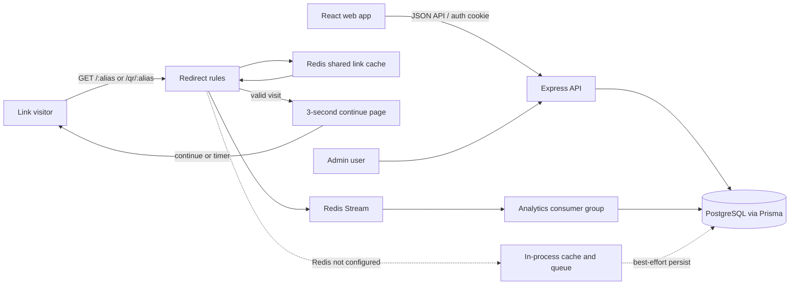

# LinkPulse

LinkPulse is a URL shortener and link operations dashboard. It combines governed redirects (expiry, click limits, passwords, and disable controls) with campaign organization, privacy-conscious click analytics, QR creation, CSV import, and administrator blocklisting.

## Product features

- **Accounts and roles:** Signup/login, logout, current-user session, HTTP-only JWT cookie, and role-protected administration.
- **Link management:** Create, validate, list, edit, delete, and organize short links. Aliases are checked for availability; links can have a title, campaign, tags, expiry, click limit, and password.
- **Redirect governance:** Public `/:alias` and `/qr/:alias` requests evaluate link status, expiry, click limit, password, and destination blocklist. Valid visits go through a branded three-second continue page with an immediate action; QR-origin visits are marked separately. Blocked visits can be recorded with a reason.
- **Campaigns and tags:** Create and manage campaigns and personal tags, archive campaigns, assign links, and bulk-move or bulk-tag selected links.
- **Analytics:** Overview KPIs, zero-filled time series, device/channel/browser breakdowns, geographic summaries, and smart alerts. Bot events are excluded from human traffic KPIs.
- **QR designer:** Generate and customize QR codes in the browser and download PNG/SVG without sending destination data to an external QR service.
- **CSV import:** Parse and commit URL rows, report added/duplicate/rejected outcomes, and download a report for rows that need correction.
- **Admin controls:** Review platform links, disable a link, and manage a global blocked-domain list.

## Technology

| Area | Stack |
|---|---|
| Runtime | Node.js (use Node 22.12+; current Vite/Vitest toolchain requires a modern Node release) |
| Monorepo | npm workspaces: root, `server`, and `web` |
| Frontend | React 19, TypeScript, Vite 8, Tailwind CSS 3, React Router 7, TanStack Query 5 |
| Charts and UI | Recharts, Lucide React, `qr-code-styling`, Papa Parse |
| Backend | Express 5, TypeScript, Zod |
| Database | PostgreSQL 15+ with Prisma 5 |
| Cache and analytics queue | Redis 7 (shared cache and Streams); `lru-cache` fallback when Redis is not configured |
| Redirect and event enrichment | `isbot`, `ua-parser-js`, `geoip-lite` |
| Authentication | bcrypt password hashes and JWT in an HTTP-only cookie |

## Architecture

LinkPulse is a **modular monolith**: one Express API and one React web app use PostgreSQL, with Redis providing shared redirect caching and durable analytics event delivery in production. Backend domains are separated into modules under `server/src/modules/` (auth, links, campaigns, tags, redirect, clicks, analytics, import, and admin). Prisma schema and migrations live in `server/prisma/`.



### Request and event workflows

**Authenticated product request:** the browser calls the API through the shared Axios client. Authentication middleware verifies the HTTP-only JWT cookie; role middleware protects admin routes. Route modules validate inputs (Zod where applicable), scope user data to the owner, call domain services/Prisma, and return JSON. React Router protects authenticated pages and TanStack Query manages server state.

**Short-link redirect:** a visitor requests `/:alias` or `/qr/:alias`. The redirect module checks the shared Redis cache (30-second TTL) and evaluates the centralized rule engine: link existence, status, expiry, click limit, password gate, and blocked destination domain. Valid visits go to a branded three-second interstitial with an immediate continue action. Visit metadata is enriched with bot classification, user-agent device/browser/OS, referrer/channel, and available geo-IP information, then appended to a Redis Stream. A consumer group writes each event and its unlimited-link click counter in one idempotent Prisma transaction; click-limit accounting is updated atomically on admission and bots do not increment the human click count. When Redis is not configured in local development, LinkPulse uses an in-process LRU cache and best-effort event queue.

**Analytics:** analytics queries read persisted `ClickEvent` data, exclude bots from human KPIs, and return overview, time series, breakdown, geo, and alert results to the frontend charts and cards.

**Operational note:** production requires Redis. It shares short-link cache entries across API instances and keeps analytics events in a Redis Stream until PostgreSQL persistence succeeds. Local development can omit Redis and use the best-effort in-memory fallback. Redis AOF and the Compose volume persist local stream data; a managed production Redis service still needs persistence and backup settings appropriate to its plan.

## Backend data model

The Prisma source of truth is [`server/prisma/schema.prisma`](server/prisma/schema.prisma). `String` IDs use Prisma `cuid()` defaults unless noted. `?` means nullable; unique keys and important indexes are called out.

| Model/table | Key columns and purpose |
|---|---|
| `User` | `id`, unique `email`, `name`, `passwordHash`, `role` (`USER`/`ADMIN`, default `USER`), `timezone` (default `UTC`), `createdAt`. Owns links, campaigns, and tags. |
| `Campaign` | `id`, `ownerId`, `name`, `category`, optional `startsAt`, `endsAt`, `archivedAt`, `description`, `createdAt`. Unique `(ownerId, name)`; campaign deletion unassigns links (`Link.campaignId` uses `SetNull`). |
| `Tag` | `id`, `ownerId`, `name`. Unique `(ownerId, name)`. |
| `Link` | `id`, `ownerId`, optional `campaignId`, unique `alias`, `destinationUrl`, optional `title`, `status`, optional `disabledReason`, `expiresAt`, `clickLimit`, `passwordHash`, `clickCount` (default `0`), `createdAt`, `updatedAt`. Indexed by `(ownerId, createdAt)` and `campaignId`. |
| `LinkTag` | Composite primary key `(linkId, tagId)`; joins links to tags. Both references cascade on delete. |
| `ClickEvent` | `id`, `linkId`, `occurredAt`, `source` (`LINK`/`QR`), `isBot`, `visitorHash`, optional `referrer`, `channel`, `device`, optional `browser`, `os`, `country`, `region`, `city`, `lat`, `lng`. Indexed for link/time and bot/time analytics. |
| `BlockedAttempt` | `id`, `linkId`, `occurredAt`, `reason`, `visitorHash`, optional `country`, `isBot`. Records visits prevented by link rules; indexed by link/time and reason/time. |
| `BlockedDomain` | `id`, unique `domain`, optional `reason`, `createdAt`. Platform-wide destination blocklist managed by admins. |
| `ImportBatch` | `id`, `ownerId`, `createdAt`, `added`, `rejected`, `duplicates`. Summarizes an import operation. `ownerId` is stored as a scalar; the current Prisma schema does not declare a `User` relation for it. |
| `ImportRow` | `id`, `batchId`, `url`, optional `alias`, `outcome`. Belongs to `ImportBatch`; rows cascade when a batch is deleted. |

Enums: `Role` = `USER`, `ADMIN`; `LinkStatus` = `ACTIVE`, `DISABLED`, `EXPIRED`; `ClickSource` = `LINK`, `QR`; `DeviceType` = `DESKTOP`, `MOBILE`, `TABLET`, `OTHER`; `CampaignCategory` = `EMAIL`, `SOCIAL_MEDIA`, `PAID_ADS`, `SEO`, `PARTNERSHIPS`, `EVENTS`, `OTHER`; `Channel` = `DIRECT`, `SOCIAL`, `SEARCH`, `EMAIL`, `OTHER_SITE`; `BlockReason` = `DISABLED`, `EXPIRED`, `LIMIT_REACHED`, `WRONG_PASSWORD`.

The schema does not define a foreign-key relation from `ImportBatch.ownerId` to `User`; see the Prisma schema before changing import retention or ownership behavior.

## API overview

All application API endpoints are prefixed with `/api`, except public redirects and public unlock routes.

| Area | Routes |
|---|---|
| Auth | `POST /auth/signup`, `POST /auth/login`, `POST /auth/logout`, `GET /auth/me` |
| Links | `POST /links/validate`, `GET /links/check-alias`, `POST /links`, `GET /links`, `PATCH /links/:id`, `DELETE /links/:id`, `POST /links/bulk-move`, `POST /links/bulk-tag` |
| Campaigns/tags | Campaign CRUD and archive/unarchive under `/campaigns`; tag create/list under `/tags` |
| Analytics | `GET /analytics/overview`, `/timeseries`, `/breakdowns`, `/geo`, `/alerts` |
| Import | `POST /import/commit` |
| Admin | `GET /admin/overview`, `GET /admin/links`, `POST /admin/links/:id/disable`, `POST /admin/blocklist` |
| Public | `POST /public/unlock/:alias`, `GET /public/resolve/:alias`, `GET /:alias`, `GET /qr/:alias` |

See [`docs/final/API.md`](docs/final/API.md) for the route list and [`docs/final/`](docs/final/) for algorithms, query behavior, performance notes, and requirements.

## Repository layout

```text
server/                 Express API, domain modules, Prisma schema/migrations/seed
web/                    React application, pages, shared UI, charts and QR designer
docs/design/            Product requirements, ERD, architecture and workflow specs
docs/final/             API, SRS, algorithms, queries and performance documentation
FIGMA_UI_AGENT_PROMPT.md  Ready-to-use frontend redesign brief with Figma reference image
```

## Setup and local development

Prerequisites: Node.js 22.12 or newer, npm, PostgreSQL 15+, and Redis 7+ (or Docker Desktop for the included Compose services). Redis is optional for local development but required in production.

### Windows and Docker Desktop first setup

Docker Desktop's Linux container engine on Windows requires WSL 2 and the Virtual Machine Platform Windows feature. First-time WSL setup needs an administrator PowerShell and a Windows restart:

```powershell
wsl --install --no-distribution
```

After restarting, open Docker Desktop and wait for its engine to become ready. In Docker Desktop, enable **Settings > General > Start Docker Desktop when you sign in**. The Redis service uses `restart: unless-stopped`, so a Redis container created with Compose starts again when Docker Desktop's engine starts after a later sign-in. The first setup still needs the `docker compose up -d redis` command below.

1. Install dependencies from the repository root:

   ```bash
   npm install
   ```

2. Start Redis with Docker (this starts only Redis, so it can use your existing local PostgreSQL on port 5432):

   ```bash
   docker compose up -d redis
   ```

   Or run Redis locally and make sure its URL matches `REDIS_URL`. PostgreSQL can be your existing local instance; its credentials must match `DATABASE_URL`.

3. If `.env` does not exist, copy `.env.example` to `.env`; otherwise preserve your current `.env` and add or update `REDIS_URL=redis://localhost:6379`. Set `DATABASE_URL`, `JWT_SECRET`, `SERVER_SALT`, `APP_URL`, and `VITE_PUBLIC_BASE_URL` to match your environment. Keep secrets private. `APP_URL` is the frontend origin; `VITE_PUBLIC_BASE_URL` is the public redirect origin. In local development these default to `http://localhost:5174` and `http://localhost:3000`. If you change ports or use deployed domains, update the matching values and restart/rebuild the relevant workspace.

   Confirm the Redis container and its health before starting the API:

   ```bash
   docker compose ps redis
   docker compose exec redis redis-cli ping
   ```

   The second command should print `PONG`. After the API starts, its log should include `Redis analytics stream ready`.

4. Generate Prisma Client and apply the database migrations from the repository root:

   ```bash
   npm run prisma:generate
   cd server
   npx prisma migrate dev --schema prisma/schema.prisma
   npx prisma db seed --schema prisma/schema.prisma
   cd ..
   ```

   Prisma generation is an explicit setup step. There is no automatic `postinstall` generation: on Windows, stop the running Node server before regenerating Prisma Client so the process releases the query-engine DLL.

5. Start both workspaces:

   ```bash
   npm run dev
   ```

   The API and short-link routes run at `http://localhost:3000`; the LinkPulse UI runs at `http://localhost:5174`. Vite uses a strict port so it reports a conflict instead of silently moving and breaking the redirect/status origin. Copied short URLs and generated QR codes use the configured public redirect origin, not the UI origin.

The seed script creates sample users, links, campaigns, tags, and historical click events. For seeded login details, see [`docs/PROGRESS.md`](docs/PROGRESS.md) and `server/prisma/seed.ts`; change development credentials before exposing a deployment. To regenerate/reset local data, use the Prisma commands intentionally and understand that database reset operations remove existing local data.

Useful commands:

```bash
npm run prisma:generate
npm run build --workspace web
```

The server workspace currently exposes `dev`, `start`, and `test` scripts but no `build` script; use `npx tsc --project server/tsconfig.json --noEmit` for a server type check. Root `npm test` delegates to workspace test scripts; inspect workspace scripts before assuming every test command is implemented.

## Delivery phases reflected in Git history

This roadmap is reconstructed from the repository's documentation and the commits currently in Git history. The feature branch `feat-linkpulse-core` was merged into `main` in commit `1842263`.

| Phase | Work recorded | Git history |
|---|---|---|
| Design pack | Product requirements, ERD, architecture, sequence diagrams, redirect decision table, and analytics metric definitions. | `0456d16` — Documentation for LinkPulse |
| 0 — Skeleton | npm monorepo, Express/Prisma backend, React/Vite frontend, PostgreSQL schema, environment setup, seed placeholder, and local dev orchestration. | `982ea06` |
| 1 — Auth and roles | Signup/login/logout/current-user, cookie JWT and bcrypt, auth/role middleware, protected UI routes, shell, and seeded user roles. | `982ea06` |
| 2 — Link creation and CRUD | Alias service, URL validation, links API, ownership checks, rate limiting, links page, and multi-step creation wizard. | `982ea06` |
| 3 — Redirect engine | Alias redirect and rule evaluation, LRU cache, bot/device/geo enrichment, queued click persistence, status/unlock pages, click-limit accounting, deployment docs, and review fixes. | `982ea06` |
| 4 — Campaigns and tags | Campaign lifecycle, tags, link assignment, bulk move/tag, campaign UI and wizard integration. | `34c7c4c` |
| 5 — Analytics | Overview, time series, breakdowns, geo summaries, alerts, and chart UI; the progress notes say the map view used a country list in place of a choropleth. | `34c7c4c` |
| 6 — QR designer | Client-side QR customization and PNG/SVG export; redirect tracking distinguishes QR visits. | `34c7c4c` |
| 7 — CSV import and admin | CSV parsing/commit/reporting, admin link takedowns, and blocked-domain management. | `34c7c4c` |
| 8–9 — Seed and final docs | Rich demo data and historical click events, final API/SRS/algorithm/query/performance docs, and final campaign detail/review fixes. | `34c7c4c`, `ce83397` |
| Merge to main | Combined the completed `feat-linkpulse-core` work with `main`. | `1842263` |

The detailed phase log is in [`docs/PROGRESS.md`](docs/PROGRESS.md); design references are in [`docs/design/`](docs/design/).

## Redirect behavior and verification

Read [`redirection.md`](redirection.md) for the redirect decision sequence, status and unlock behavior, local-port configuration, click-event enrichment, analytics recording, known runtime limits, and the proposed future Pulse Safety Record. Clicks are stored in `ClickEvent` and blocked visits in `BlockedAttempt`; a separate safety/audit record is not implemented.

Analytics currently groups daily time-series data in UTC. The saved account timezone is not yet applied to those buckets. With Redis connected, production click and blocked-attempt events are stored in a Redis Stream until a consumer persists them to PostgreSQL; local fallback buffering remains in process memory when Redis is not configured or temporarily unavailable. The actual Redis container startup on this Windows machine is pending the WSL-enabling restart.

## Figma UI redesign brief

To give an AI coding agent the frontend redesign task, start with [`FIGMA_UI_AGENT_PROMPT.md`](FIGMA_UI_AGENT_PROMPT.md). It includes the Figma foundations screenshot, exact palette, type/layout direction, route-by-route guidance, image/illustration rules, functional constraints, and implementation sequence. The current Figma file supplies foundations only, not finished product screens.
