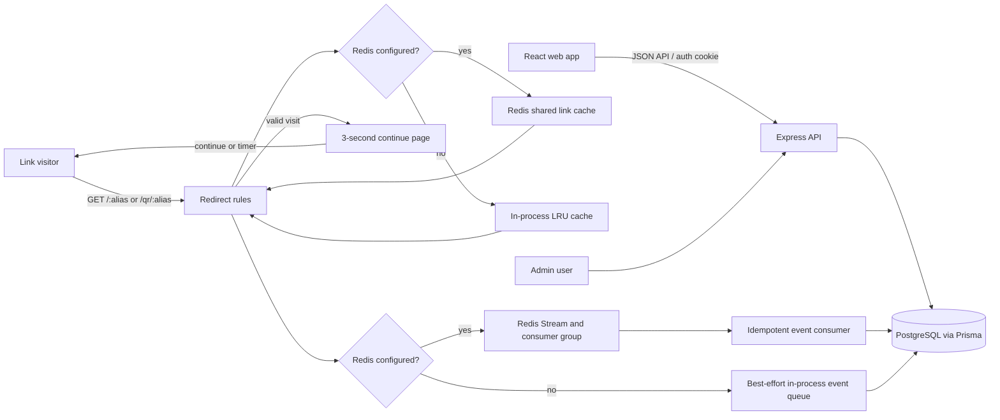

# LinkPulse

> **PROJECT GUIDE | PRODUCT, SETUP AND OPERATIONS**

## Contents

- [Problem statement](#problem-statement)
- [Solution](#solution)
- [Live link](#live-link)
- [Screenshots](#screenshots)
- [Product features](#product-features)
- [Technology](#technology)
- [Architecture](#architecture)
- [Backend data model](#backend-data-model)
- [API overview](#api-overview)
- [Documentation map](#documentation-map)
- [Repository layout](#repository-layout)
- [Setup and local development](#setup-and-local-development)
- [Local versus deployment model](#local-versus-deployment-model)
- [Lightweight deployment on Render](#lightweight-deployment-on-render)
- [Delivery phases reflected in Git history](#delivery-phases-reflected-in-git-history)
- [Redirect behavior and verification](#redirect-behavior-and-verification)
- [Figma UI redesign brief](#figma-ui-redesign-brief)

> **Governed links. Clear analytics. Practical controls.**
>
> LinkPulse is a URL shortener and link operations dashboard for creating, organizing, measuring, and governing public links.

| Project | Current state |
|---|---|
| Deployment | Not deployed |
| Required data store | PostgreSQL 15+ |
| Optional scale-up | Redis 7+ |
| App shape | React dashboard + Express modular monolith |

**Start here:** [Set up locally](#setup-and-local-development) · [Understand the architecture](#architecture) · [Deploy](#lightweight-deployment-on-render) · [Browse all documentation](#documentation-map)

LinkPulse combines governed redirects (expiry, click limits, passwords, and disable controls) with campaign organization, privacy-conscious click analytics, QR creation, CSV import, and administrator blocklisting.

## Problem statement

Teams share long URLs that are difficult to remember, hard to govern, and easy to lose track of. A basic shortener creates a redirect, but it does not provide a safe way to expire links, pause harmful destinations, protect links with a password, understand traffic, or give administrators platform-wide control.

## Solution

LinkPulse creates readable short aliases and evaluates every visit through one redirect service. The same Express service can serve the React dashboard, API, public short links, QR routes, and redirect interstitial. PostgreSQL is the required data store; Redis is optional for shared caching and durable analytics streaming when the project grows beyond a lightweight single-service deployment.

> **Read the diagrams:** the maintained system map and current request flows are in [Architecture](docs/design/03-architecture.md) and [Sequence diagrams](docs/design/04-sequence-diagrams.md).

## Live link

**Not deployed yet.** After deploying the included Docker setup to Render, replace the placeholder below with the real service URL:

```text
https://<your-render-service>.onrender.com
```

For a custom domain, use the same service with a domain you control, for example `https://go.yourdomain.com` for public links and `https://app.yourdomain.com` for the dashboard. The simplest first deployment can use one origin for both.

## Screenshots

The repository includes the supplied product-design screenshots for the main flows:

| Flow | Screenshot |
|---|---|
| Dashboard | [Dashboard — Start here](<LinkPulse — Product Design (2)/01/01/Dashboard — Start here.png>) |
| Link management | [Links](<LinkPulse — Product Design (2)/01/02/Links.png>) |
| Create a link | [Destination and alias](<LinkPulse — Product Design (2)/01/03/Create link — Destination & alias.png>) |
| Analytics | [Analytics](<LinkPulse — Product Design (2)/01/05/Analytics.png>) |
| Public redirect | [Public short link](<LinkPulse — Product Design (2)/01/06/Public — Short Link.png>) |
| QR flow | [Public QR code](<LinkPulse — Product Design (2)/01/07/Public — QR Code.png>) |

These are product reference images stored in the repository; replace or supplement them with deployed runtime screenshots once the first live environment is available.

## Product features

- **Accounts and roles:** Signup/login, logout, current-user session, HTTP-only JWT cookie, and role-protected administration.
- **Link management:** Create, validate, list, edit, delete, and organize short links. Aliases are checked for availability; links can have a title, campaign, tags, expiry, click limit, and password.
- **Redirect governance:** Public `/:alias` and `/qr/:alias` requests evaluate link status, expiry, click limit, password, and destination blocklist. Valid visits go through a branded three-second continue page with an immediate action; QR-origin visits are marked separately. Blocked visits can be recorded with a reason.
- **Campaigns and tags:** Create and manage campaigns and personal tags, archive campaigns, assign links, and bulk-move or bulk-tag selected links.
- **Analytics:** Overview KPIs, zero-filled time series, device/channel/browser breakdowns, geographic summaries, and smart alerts. Bot events are excluded from human traffic KPIs.
- **QR designer:** Generate and customize QR codes in the browser and download PNG/SVG without sending destination data to an external QR service.
- **CSV import:** Parse and commit URL rows, report added/duplicate/rejected outcomes, and download a report for rows that need correction.
- **Super-admin controls:** The `ADMIN` role is the platform-wide super-admin. It can review overview metrics, search/filter/sort every platform link, activate or disable links, manage user account access, review recent traffic/blocked attempts, and maintain a global blocked-domain list.

## Technology

| Area | Stack |
|---|---|
| Runtime | Node.js (use Node 22.12+; current Vite/Vitest toolchain requires a modern Node release) |
| Monorepo | npm workspaces: root, `server`, and `web` |
| Frontend | React 19, TypeScript, Vite 8, Tailwind CSS 3, React Router 7, TanStack Query 5 |
| Charts and UI | Recharts, Lucide React, `qr-code-styling`, Papa Parse |
| Backend | Express 5, TypeScript, Zod |
| Database | PostgreSQL 15+ with Prisma 5 |
| Cache and analytics queue | Local LRU and in-process queue by default; optional Redis 7 shared cache and Streams |
| Redirect and event enrichment | `isbot`, `ua-parser-js`, `geoip-lite` |
| Authentication | bcrypt password hashes and JWT in an HTTP-only cookie |

## Architecture

LinkPulse is a **modular monolith**: one Express service and one React web app use PostgreSQL. In production, Express serves the compiled React app, API, and public redirects from one lightweight service. Redis is an optional scale-up for shared redirect caching and durable analytics event delivery. Backend domains are separated into modules under `server/src/modules/` (auth, links, campaigns, tags, redirect, clicks, analytics, import, and admin). Prisma schema and migrations live in `server/prisma/`.



### Request and event workflows

**Authenticated product request:** the browser calls the API through the shared Axios client. Authentication middleware verifies the HTTP-only JWT cookie; role middleware protects admin routes. Route modules validate inputs (Zod where applicable), scope user data to the owner, call domain services/Prisma, and return JSON. React Router protects authenticated pages and TanStack Query manages server state.

**Short-link redirect:** a visitor requests `/:alias` or `/qr/:alias`. The redirect module checks the shared Redis cache (30-second TTL) and evaluates the centralized rule engine: link existence, status, expiry, click limit, password gate, and blocked destination domain. Valid visits go to a branded three-second interstitial with an immediate continue action. Visit metadata is enriched with bot classification, user-agent device/browser/OS, referrer/channel, and available geo-IP information, then appended to a Redis Stream. A consumer group writes each event and its unlimited-link click counter in one idempotent Prisma transaction; click-limit accounting is updated atomically on admission and bots do not increment the human click count. When Redis is not configured in local development, LinkPulse uses an in-process LRU cache and best-effort event queue.

**Analytics:** analytics queries read persisted `ClickEvent` data, exclude bots from human KPIs, and return overview, time series, breakdown, geo, and alert results to the frontend charts and cards.

**Operational note:** the lightweight deployment does not require Redis. Without Redis, LinkPulse uses a process-local LRU cache and a best-effort in-process analytics queue that writes to PostgreSQL. Add Redis when running multiple API instances or when durable stream buffering and shared cache are required. Redis AOF and the Compose volume persist the optional local stream; a managed production Redis service still needs persistence and backup settings appropriate to its plan.

## Backend data model

The Prisma source of truth is [`server/prisma/schema.prisma`](server/prisma/schema.prisma). `String` IDs use Prisma `cuid()` defaults unless noted. `?` means nullable; unique keys and important indexes are called out.

| Model/table | Key columns and purpose |
|---|---|
| `User` | `id`, unique `email`, `name`, `passwordHash`, `role` (`USER`/`ADMIN`, default `USER`), `isActive`, `timezone` (default `UTC`), `createdAt`. Owns links, campaigns, and tags. |
| `Campaign` | `id`, `ownerId`, `name`, `category`, optional `startsAt`, `endsAt`, `archivedAt`, `description`, `createdAt`. Unique `(ownerId, name)`; campaign deletion unassigns links (`Link.campaignId` uses `SetNull`). |
| `Tag` | `id`, `ownerId`, `name`. Unique `(ownerId, name)`. |
| `Link` | `id`, `ownerId`, optional `campaignId`, unique `alias`, `destinationUrl`, optional `title`, `status`, optional `disabledReason`, `expiresAt`, `clickLimit`, `passwordHash`, `clickCount` (default `0`), `createdAt`, `updatedAt`. Indexed by `(ownerId, createdAt)` and `campaignId`. |
| `LinkTag` | Composite primary key `(linkId, tagId)`; joins links to tags. Both references cascade on delete. |
| `ClickEvent` | `id`, `linkId`, `occurredAt`, `source` (`LINK`/`QR`), `isBot`, `visitorHash`, optional `referrer`, `channel`, `device`, optional `browser`, `os`, `country`, `region`, `city`, `lat`, `lng`. Indexed for link/time and bot/time analytics. |
| `BlockedAttempt` | `id`, `linkId`, `occurredAt`, `reason`, `visitorHash`, optional `country`, `isBot`. Records visits prevented by link rules; indexed by link/time and reason/time. |
| `BlockedDomain` | `id`, unique `domain`, optional `reason`, `createdAt`. Platform-wide destination blocklist managed by admins. |
| `ImportBatch` | `id`, `ownerId`, `createdAt`, `added`, `rejected`, `duplicates`. Summarizes an import operation. `ownerId` is stored as a scalar; the current Prisma schema does not declare a `User` relation for it. |
| `ImportRow` | `id`, `batchId`, `url`, optional `alias`, `outcome`. Belongs to `ImportBatch`; rows cascade when a batch is deleted. |

Enums: `Role` = `USER`, `ADMIN`; `LinkStatus` = `ACTIVE`, `DISABLED`, `EXPIRED`; `ClickSource` = `LINK`, `QR`; `DeviceType` = `DESKTOP`, `MOBILE`, `TABLET`, `OTHER`; `CampaignCategory` = `EMAIL`, `SOCIAL_MEDIA`, `PAID_ADS`, `SEO`, `PARTNERSHIPS`, `EVENTS`, `OTHER`; `Channel` = `DIRECT`, `SOCIAL`, `SEARCH`, `EMAIL`, `OTHER_SITE`; `BlockReason` = `DISABLED`, `EXPIRED`, `LIMIT_REACHED`, `WRONG_PASSWORD`.

The schema does not define a foreign-key relation from `ImportBatch.ownerId` to `User`; see the Prisma schema before changing import retention or ownership behavior.

## API overview

Application APIs, including public unlock and destination resolution, are prefixed with `/api`. Browser short-link routes (`/:alias`, `/qr/:alias`) are served at the Express origin.

| Area | Routes |
|---|---|
| Auth | `POST /auth/signup`, `POST /auth/login`, `POST /auth/logout`, `GET /auth/me` |
| Links | `POST /links/validate`, `GET /links/check-alias`, `POST /links`, `GET /links`, `PATCH /links/:id`, `DELETE /links/:id`, `POST /links/bulk-move`, `POST /links/bulk-tag` |
| Campaigns/tags | Campaign CRUD and archive/unarchive under `/campaigns`; tag create/list under `/tags` |
| Analytics | `GET /analytics/overview`, `/timeseries`, `/breakdowns`, `/geo`, `/alerts` |
| Import | `POST /import/commit` |
| Admin / super-admin | `GET /admin/overview`, `GET /admin/users`, `PATCH /admin/users/:id/status`, `GET /admin/links`, `PATCH /admin/links/:id/status`, `GET /admin/activity`, `GET /admin/blocklist`, `POST /admin/blocklist`, `DELETE /admin/blocklist/:id` |
| Public API | `POST /api/public/unlock/:alias`, `GET /api/public/resolve/:alias` |
| Public redirects | `GET /:alias`, `GET /qr/:alias` |

See [`docs/final/API.md`](docs/final/API.md) for the route list and [`docs/final/`](docs/final/) for algorithms, query behavior, performance notes, and requirements.

## Documentation map

| Guide | What it covers |
|---|---|
| [Deployment](docs/DEPLOYMENT.md) | Environment variables, Render, migrations, optional Redis, release checks |
| [Redirect operations](redirection.md) | Redirect rules, continue tokens, click recording, Redis behavior, known limits |
| [Progress log](docs/PROGRESS.md) | Delivery history and current verification notes |
| [Release notes](Bugs.md) | Fixed issues, current gaps, verification snapshot |
| [Product design pack](docs/design/01-prd.md) | PRD, ERD, architecture, flows, redirect rules, metric definitions |
| [Final technical reference](docs/final/API.md) | API, requirements, algorithms, analytics queries, performance |
| [Frontend workspace](web/README.md) | Browser route map and frontend commands |
| [Figma redesign brief](FIGMA_UI_AGENT_PROMPT.md) | Implementation brief and reference guidance |

## Repository layout

```text
server/                 Express API, domain modules, Prisma schema/migrations/seed
web/                    React application, pages, shared UI, charts and QR designer
docs/design/            Product requirements, ERD, architecture and workflow specs
docs/final/             API, SRS, algorithms, queries and performance documentation
FIGMA_UI_AGENT_PROMPT.md  Ready-to-use frontend redesign brief with Figma reference image
```

## Setup and local development

Prerequisites: Node.js 22.12 or newer, npm, and PostgreSQL 15+. Redis 7+ is optional. The project has one backend contract in both environments: Express owns `/api`, `/:alias`, `/qr/:alias`, and the production SPA; Vite only provides HMR during local frontend development.

### Windows and Docker Desktop first setup

Docker Desktop's Linux container engine on Windows requires WSL 2 and the Virtual Machine Platform Windows feature. First-time WSL setup needs an administrator PowerShell and a Windows restart:

```powershell
wsl --install --no-distribution
```

After restarting, open Docker Desktop and wait for its engine to become ready. Docker is optional if PostgreSQL is already installed locally. The first setup can use only the PostgreSQL Compose service; Redis is an optional scale-up.

1. Install dependencies from the repository root:

   ```bash
   npm install
   ```

2. Start PostgreSQL using your existing installation or the Compose service. Redis is optional; do not start it for the lightest setup:

   ```bash
   docker compose up -d postgres
   ```

   PostgreSQL can also be your existing local instance; its credentials must match `DATABASE_URL`. If Redis is available later, set `REDIS_URL=redis://localhost:6379`; otherwise leave it empty.

3. If `.env` does not exist, copy `.env.example` to `.env`; otherwise preserve your current `.env`. Set `DATABASE_URL`, `JWT_SECRET`, `SERVER_SALT`, `APP_URL`, and `VITE_PUBLIC_BASE_URL` to match your environment. Keep secrets private. During local development, `APP_URL=http://localhost:5174` and `VITE_PUBLIC_BASE_URL=http://localhost:3000` keep Vite HMR separate from the Express redirect origin. In a unified production deployment, build and serve the SPA from Express and set both values to the public service origin unless you intentionally use separate custom dashboard and short-link domains.

4. Generate Prisma Client and apply the database migrations from the repository root:

   ```bash
   npm run prisma:generate
   cd server
   npx prisma migrate dev --schema prisma/schema.prisma
   npx prisma db seed --schema prisma/schema.prisma
   cd ..
   ```

   Prisma generation is an explicit setup step. There is no automatic `postinstall` generation: on Windows, stop the running Node server before regenerating Prisma Client so the process releases the query-engine DLL.

5. Start both workspaces:

   ```bash
   npm run dev
   ```

   The API and short-link routes run at `http://localhost:3000`; the LinkPulse UI runs at `http://localhost:5174`. Vite uses a strict port so it reports a conflict instead of silently moving and breaking the redirect/status origin. Copied short URLs and generated QR codes use the configured public redirect origin, not the UI origin.

The seed script creates sample users, links, campaigns, tags, and historical click events. For seeded login details, see [`docs/PROGRESS.md`](docs/PROGRESS.md) and `server/prisma/seed.ts`; change development credentials before exposing a deployment. To regenerate/reset local data, use the Prisma commands intentionally and understand that database reset operations remove existing local data.

## Local versus deployment model

There is one application boundary, not two separate backend implementations:

```text
Local development:
  Vite :5174  --proxy /api-->  Express :3000  --> PostgreSQL
  short link: http://localhost:3000/alias

Unified deployment:
  Render Web Service :443  --> Express
       ├── React web/dist
       ├── /api/*
       ├── /:alias and /qr/:alias
       └── PostgreSQL
  optional Redis for multi-instance scale
```

The Dockerfile builds both workspaces, and Express serves `web/dist` when it exists. API, QR, and generic public-alias routes are evaluated before the SPA fallback, so a short link cannot accidentally return the dashboard HTML.

## Lightweight deployment on Render

Use one Render **Web Service** backed by one managed PostgreSQL database:

1. Create the service from this repository and let Render use `server/Dockerfile`.
2. Set `DATABASE_URL`, `JWT_SECRET`, `SERVER_SALT`, and `APP_URL` to the service's HTTPS origin.
3. Leave `REDIS_URL` empty for the lightest one-instance deployment. Add managed Redis later for multi-instance shared cache and durable stream buffering.
4. Leave `VITE_PUBLIC_BASE_URL` empty for same-origin short links, or set it at build time to a custom public redirect domain such as `https://go.example.com`.
5. Deploy, then confirm `/health`, `/login`, and a generated `/:alias` redirect. The container runs Prisma migrations before starting Express.

For the full environment and custom-domain checklist, see [`docs/DEPLOYMENT.md`](docs/DEPLOYMENT.md).

Useful commands:

```bash
npm run prisma:generate
npm run build
npm run build --workspace web
```

`npm run build` at the repository root builds the web bundle first and then the Express server, which is the same order used by the unified deployment image.

The server workspace exposes `dev`, `build`, `start`, and `test` scripts. Root `npm test` delegates to workspace test scripts; the database E2E file remains opt-in with `RUN_DB_TESTS=1`.

## Delivery phases reflected in Git history

This roadmap is reconstructed from the repository's documentation and the commits currently in Git history. The feature branch `feat-linkpulse-core` was merged into `main` in commit `1842263`.

| Phase | Work recorded | Git history |
|---|---|---|
| Design pack | Product requirements, ERD, architecture, sequence diagrams, redirect decision table, and analytics metric definitions. | `0456d16` — Documentation for LinkPulse |
| 0 — Skeleton | npm monorepo, Express/Prisma backend, React/Vite frontend, PostgreSQL schema, environment setup, seed placeholder, and local dev orchestration. | `982ea06` |
| 1 — Auth and roles | Signup/login/logout/current-user, cookie JWT and bcrypt, auth/role middleware, protected UI routes, shell, and seeded user roles. | `982ea06` |
| 2 — Link creation and CRUD | Alias service, URL validation, links API, ownership checks, rate limiting, links page, and multi-step creation wizard. | `982ea06` |
| 3 — Redirect engine | Alias redirect and rule evaluation, LRU cache, bot/device/geo enrichment, queued click persistence, status/unlock pages, click-limit accounting, deployment docs, and review fixes. | `982ea06` |
| 4 — Campaigns and tags | Campaign lifecycle, tags, link assignment, bulk move/tag, campaign UI and wizard integration. | `34c7c4c` |
| 5 — Analytics | Overview, time series, breakdowns, geo summaries, alerts, and chart UI; the progress notes say the map view used a country list in place of a choropleth. | `34c7c4c` |
| 6 — QR designer | Client-side QR customization and PNG/SVG export; redirect tracking distinguishes QR visits. | `34c7c4c` |
| 7 — CSV import and admin | CSV parsing/commit/reporting, admin link takedowns, and blocked-domain management. | `34c7c4c` |
| 8–9 — Seed and final docs | Rich demo data and historical click events, final API/SRS/algorithm/query/performance docs, and final campaign detail/review fixes. | `34c7c4c`, `ce83397` |
| Merge to main | Combined the completed `feat-linkpulse-core` work with `main`. | `1842263` |

The detailed phase log is in [`docs/PROGRESS.md`](docs/PROGRESS.md); design references are in [`docs/design/`](docs/design/).

## Redirect behavior and verification

Read [`redirection.md`](redirection.md) for the redirect decision sequence, status and unlock behavior, local-port configuration, click-event enrichment, analytics recording, known runtime limits, and the proposed future Pulse Safety Record. Clicks are stored in `ClickEvent` and blocked visits in `BlockedAttempt`; a separate safety/audit record is not implemented.

Analytics currently groups daily time-series data in UTC. The saved account timezone is not yet applied to those buckets. With Redis connected, production click and blocked-attempt events are stored in a Redis Stream until a consumer persists them to PostgreSQL; local fallback buffering remains in process memory when Redis is not configured or temporarily unavailable. The actual Redis container startup on this Windows machine is pending the WSL-enabling restart.

## Figma UI redesign brief

To give an AI coding agent the frontend redesign task, start with [`FIGMA_UI_AGENT_PROMPT.md`](FIGMA_UI_AGENT_PROMPT.md). It includes the Figma foundations screenshot, exact palette, type/layout direction, route-by-route guidance, image/illustration rules, functional constraints, and implementation sequence. The current Figma file supplies foundations only, not finished product screens.
