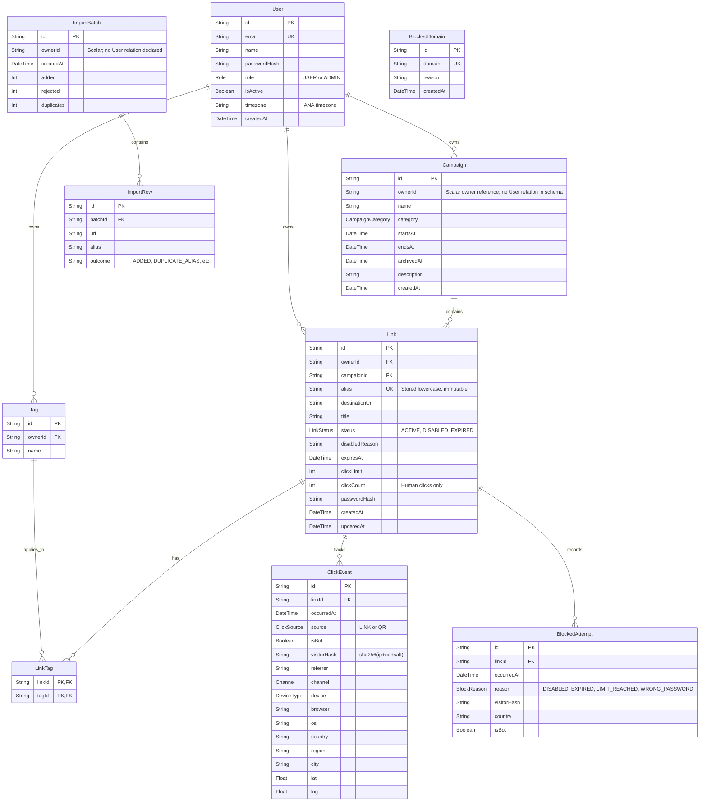

# Entity Relationship Diagram (ERD)

> **DESIGN PACK | 02 OF 06 | DATA MODEL**

## Contents

- [Entity Descriptions](#entity-descriptions)

## Entity Descriptions

| Entity | Purpose and relationship notes |
|---|---|
| `User` | Registered account with `USER` or `ADMIN` role and active status. Owns links, campaigns, and tags. |
| `Campaign` | User-owned grouping for links; optional dates and archive timestamp. Deleting a campaign unassigns links. |
| `Tag` | User-owned label connected to links through `LinkTag`. |
| `Link` | Short URL, destination, status, access rules, and click counter. |
| `LinkTag` | Composite-key many-to-many join; either parent deletion cascades. |
| `ClickEvent` | Human or bot visit with source, daily visitor hash, and available device/referrer/geo fields. |
| `BlockedAttempt` | Visit rejected by a redirect rule; records the reason and privacy-preserving visitor hash. |
| `BlockedDomain` | Platform-wide unique destination hostname maintained by super-admins. |
| `ImportBatch` | Import summary; `ownerId` is a scalar and the current schema has no relation to `User`. |
| `ImportRow` | Per-row result belonging to a batch; rows cascade when the batch is deleted. |

> **Schema source of truth:** [`server/prisma/schema.prisma`](../../server/prisma/schema.prisma). This ERD describes declared Prisma relations; `ImportBatch.ownerId` is intentionally shown without a foreign-key edge.
