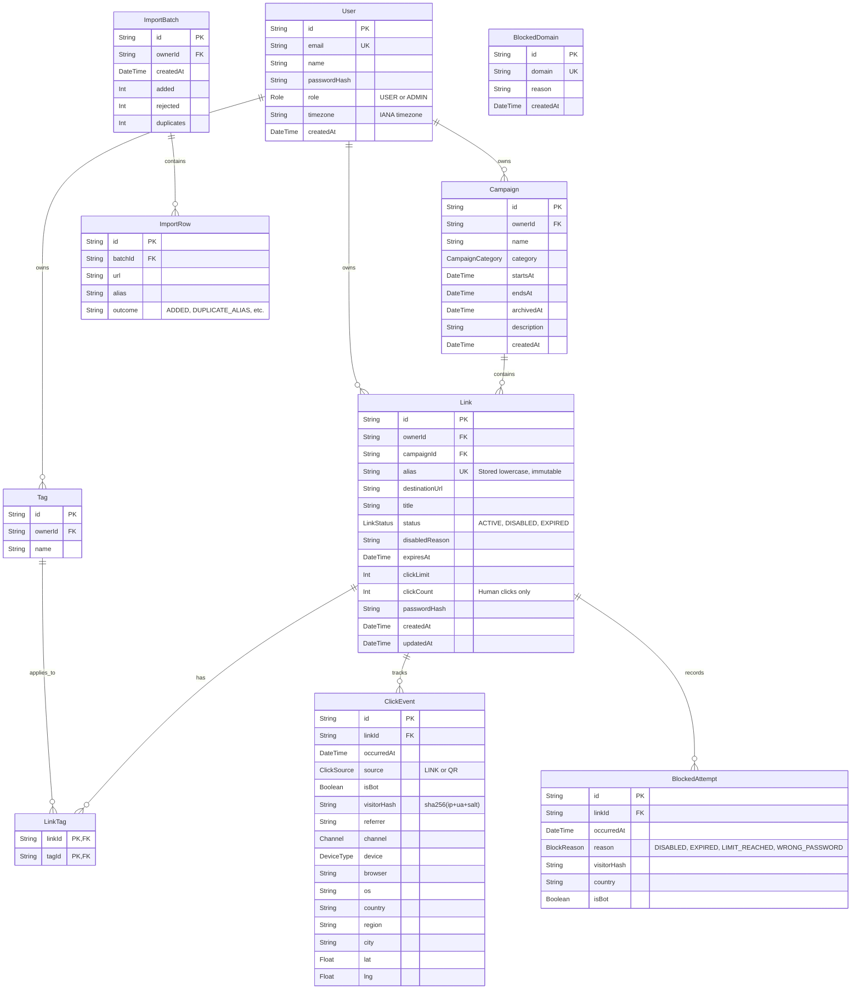

# Entity Relationship Diagram (ERD)

## Entity Descriptions
- **User**: Represents a person registered in the system, either a standard USER or an ADMIN.
- **Campaign**: A time-bound organizational grouping for links, owned by a specific User.
- **Tag**: A label to organize links, owned by a specific User.
- **Link**: The core entity representing a short URL, storing its destination, rules, and current status.
- **LinkTag**: A many-to-many relationship mapping between Links and Tags.
- **ClickEvent**: An occurrence of a human or bot visiting a Link, enriched with geo and device data.
- **BlockedAttempt**: A record of a visit that failed to redirect due to rules (e.g., limit reached, disabled).
- **BlockedDomain**: A platform-wide list of domains that are not allowed as destinations (managed by Admin).
- **ImportBatch**: A record of a bulk CSV upload session for auditing and progress tracking.
- **ImportRow**: The outcome of an individual row processed within an ImportBatch.
