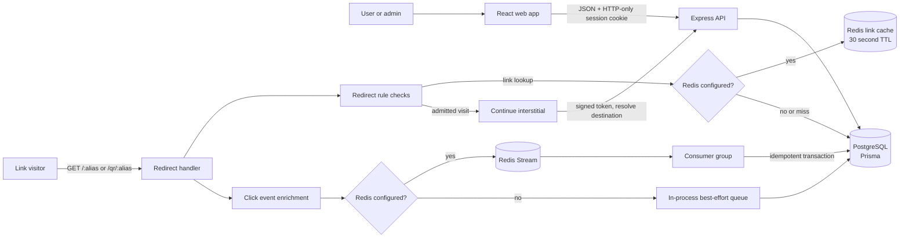
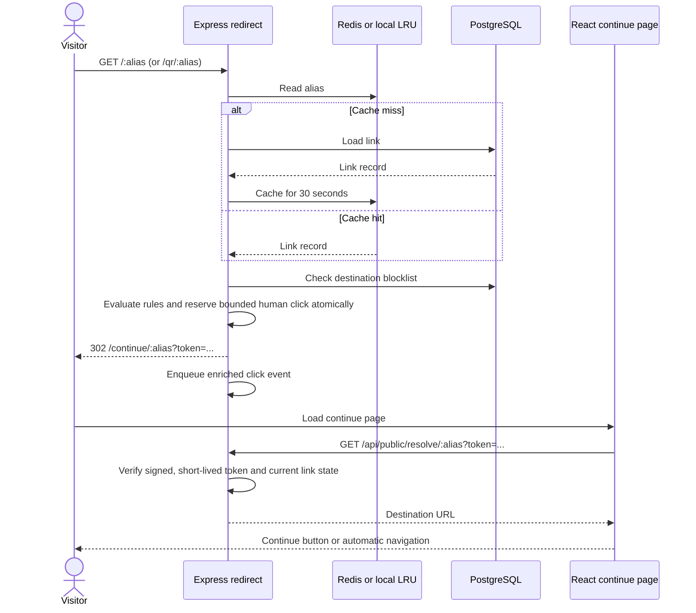
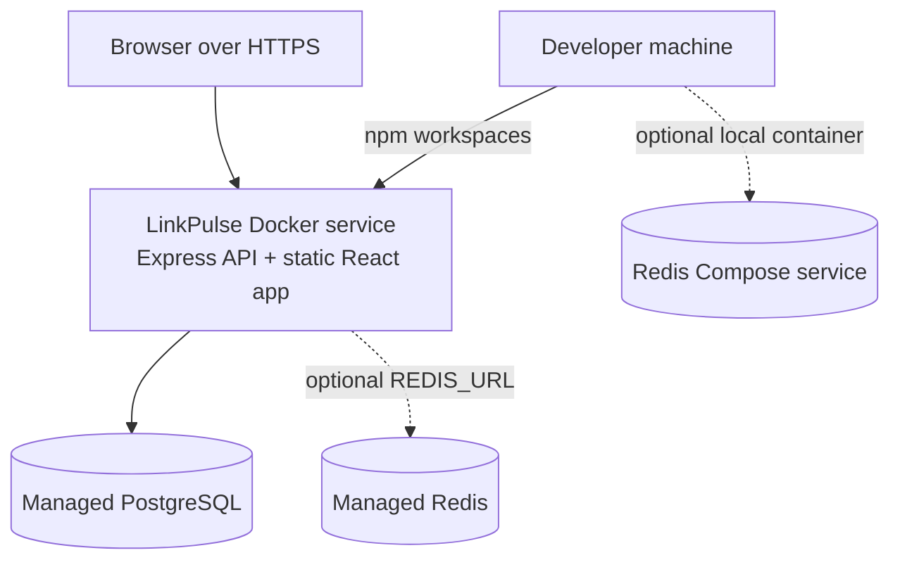

# LinkPulse Architecture

> **DESIGN PACK | 03 OF 06 | ARCHITECTURE**

## Contents

- [System at a glance](#system-at-a-glance)
- [Runtime boundaries](#runtime-boundaries)
- [Request paths](#request-paths)
- [Deployment shape](#deployment-shape)
- [Technology choices](#technology-choices)

> **Design pack · 03 / 06** · System boundaries, request paths, and deployment shape

[← Product brief](01-prd.md) · [Data model →](02-erd.md) · [Sequence flows →](04-sequence-diagrams.md)

## System at a glance

LinkPulse is a modular monolith: one Express service owns authenticated APIs and public redirects, while one React application provides dashboard and public browser flows. PostgreSQL is required. Redis is optional and adds a shared link cache and durable analytics stream processing.

## Runtime boundaries

| Component | Responsibility | Source of truth / fallback |
|---|---|---|
| React web app | Authenticated product UI and public continue, unlock, and status pages | Express API; browser does not store unlocked destinations |
| Express API | Auth, user-scoped CRUD, analytics, import, admin controls, static app serving | Validates input and enforces ownership/role boundaries |
| Redirect module | Rule evaluation, atomic bounded-click admission, continue URL creation | PostgreSQL link and blocklist state; cache accelerates link reads |
| PostgreSQL | Users, links, campaigns, tags, events, blocked attempts, imports | Required durable application store |
| Redis | Shared 30-second link cache and stream-backed analytics queue | Optional; no-Redis mode uses local LRU and in-process queue |
| Analytics consumer | Enrichment persistence and click-count update | Redis mode uses idempotent transactional persistence |

## Request paths

### Dashboard request

1. The browser calls `/api/...` with the session cookie.
2. Auth middleware checks the session; admin routes additionally require `ADMIN` and an active account.
3. Route schemas validate input, user-owned operations scope by owner, and Prisma reads or writes PostgreSQL.
4. The frontend renders results and explicit loading, error, and empty states.

### Public redirect

The signed continue token expires after 120 seconds. Resolution does not record a second click. A password-protected link first uses `/api/public/unlock/:alias`; successful unlock applies the redirect checks and returns a token carrying the unlock state.

## Deployment shape

The lightweight deployment needs one Node service and managed PostgreSQL. Redis is a scale-up choice for multiple API instances or durable buffered analytics. Local Compose binds Redis to loopback and persists it in the `redisdata` volume. See [deployment operations](../DEPLOYMENT.md).

## Technology choices

| Layer | Choice | Reason in this product |
|---|---|---|
| Browser | React, TypeScript, Vite, Tailwind | Dashboard and public flows share a typed client app |
| API | Express 5, TypeScript, Zod | Modular REST endpoints with explicit validation |
| Persistence | PostgreSQL, Prisma | Constraints, transactions, relational ownership, and analytics queries |
| Optional cache/queue | Redis 7; local LRU fallback | Shared cache and stream durability without making Redis mandatory |
| Traffic enrichment | `isbot`, `ua-parser-js`, `geoip-lite` | Local bot, device, browser, and available geo classification |
| Charts and QR | Recharts; `qr-code-styling` | Product analytics and local QR generation |

> **Operational boundary:** no Redis means the process-local queue is best effort; buffered events may be lost if the process stops before persistence. Treat production Redis persistence and backups as deployment-specific responsibilities.
