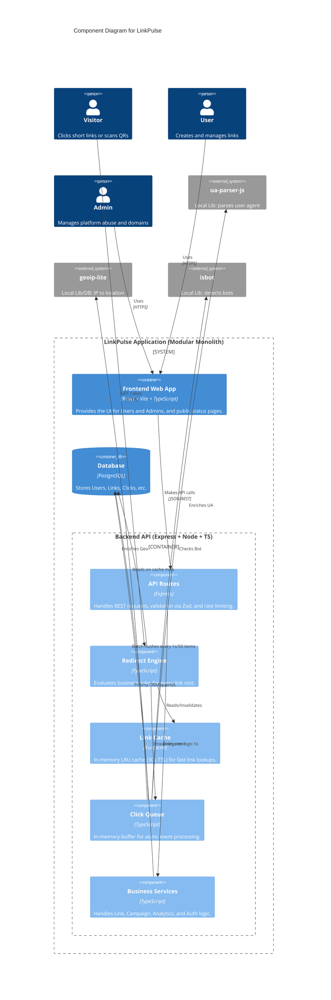
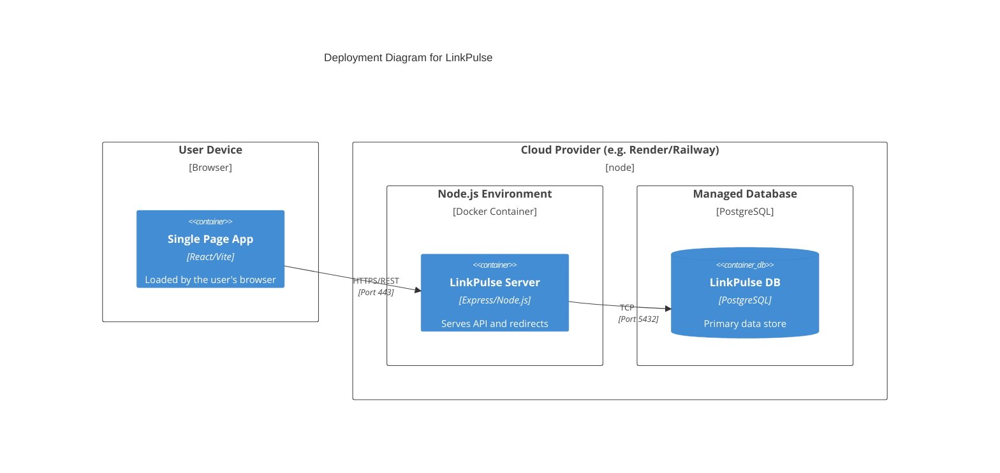

# Architecture

## Component Diagram

## Deployment Diagram

## Why This Stack
- **Frontend (React + Vite + TypeScript + Tailwind):** Fast, standard, and highly productive for building interactive UIs. Tailwind enables quick styling without writing custom CSS files. Recharts and react-simple-maps allow for offline, API-free data visualization.
- **Backend (Node 20 + Express + TypeScript):** Familiar and simple. Express is lightweight and perfect for a standard REST API.
- **ORM / DB (Prisma + PostgreSQL):** Prisma provides type-safe database access, while PostgreSQL is robust, handles unique constraints perfectly, and supports the complex analytical queries needed for the dashboard.
- **In-Memory Systems (LRU Cache & Click Queue):** Using `lru-cache` and an in-memory queue avoids the overhead of managing a Redis instance. This meets the requirement of being a "clean modular monolith" without over-engineering.
- **Local Geo & Bot Parsing:** `geoip-lite`, `isbot`, and `ua-parser-js` allow us to enrich click data quickly and entirely offline, removing the need for external API dependencies and keeping redirects fast.
