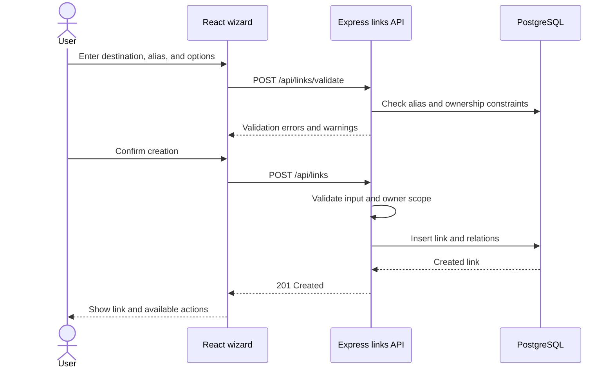
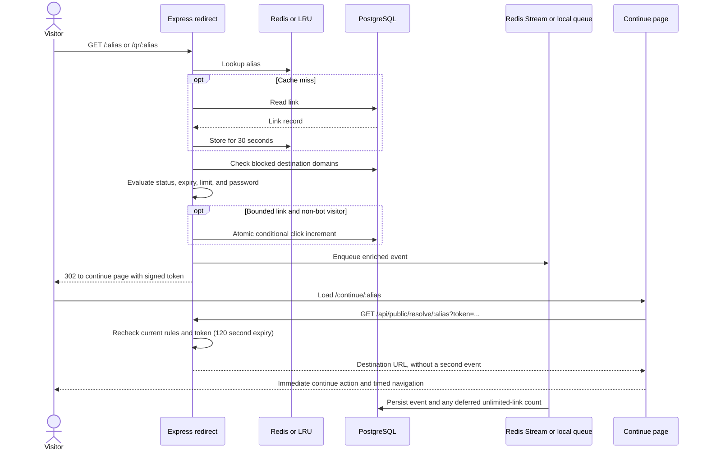
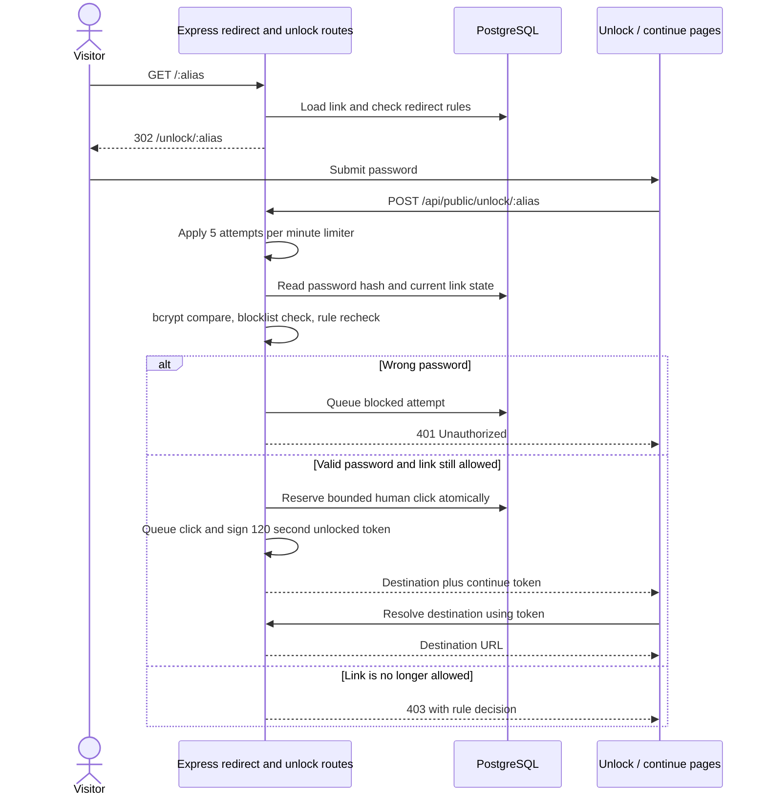
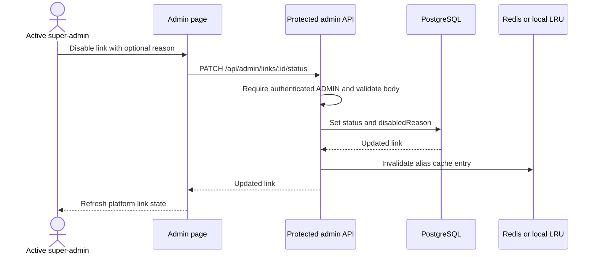

# LinkPulse Sequence Diagrams

> **DESIGN PACK | 04 OF 06 | REQUEST FLOWS**

## Contents

- [Create a link](#create-a-link)
- [Redirect and deferred analytics](#redirect-and-deferred-analytics)
- [Password-protected redirect](#password-protected-redirect)
- [Super-admin status change](#super-admin-status-change)
- [CSV import](#csv-import)

> **Design pack · 04 / 06** · Current request behavior across the browser, API, and database

[← Architecture](03-architecture.md) · [Redirect decision table →](05-redirect-decision-table.md)

## Create a link



## Redirect and deferred analytics



With Redis enabled, the consumer group persists stream entries transactionally and acknowledges them after persistence. Without Redis, the in-process queue is best effort and may lose buffered events on process exit.

## Password-protected redirect



## Super-admin status change



## CSV import

```mermaid
sequenceDiagram
    actor User
    participant Web as React import page
    participant API as Express import route
    participant DB as PostgreSQL
    User->>Web: Select CSV and map columns
    Web->>Web: Parse and preview rows
    User->>Web: Confirm import
    Web->>API: POST /api/import/commit with rows
    API->>API: Validate and process rows; classify invalid and duplicate outcomes
    API->>DB: Create valid links and batch/row result records
    DB-->>API: Persisted outcomes
    API-->>Web: Added, duplicate, and rejected results
    Web-->>User: Summary and downloadable correction report
```

> **Implementation note:** import is processed by the server with per-row validation and recorded outcomes. Do not assume the entire upload is one all-or-nothing database transaction.
