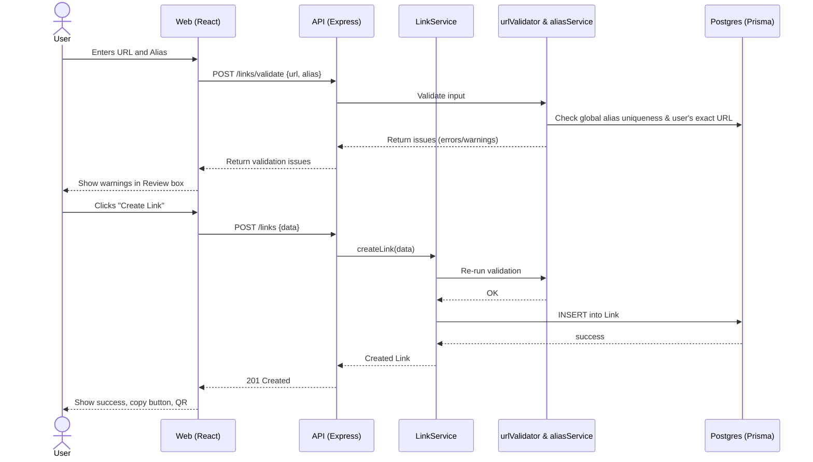
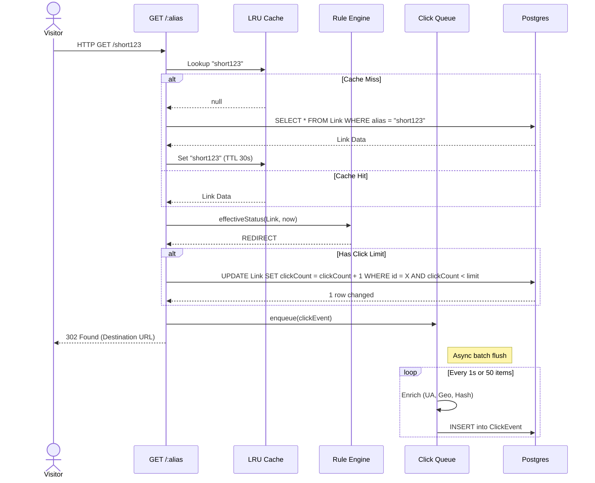
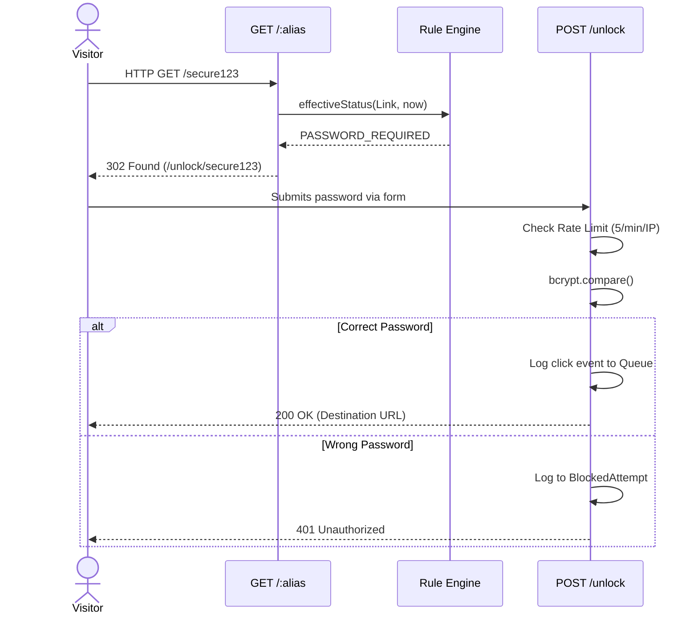
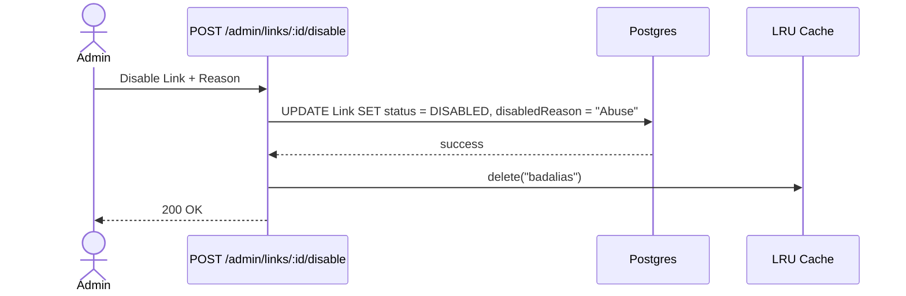
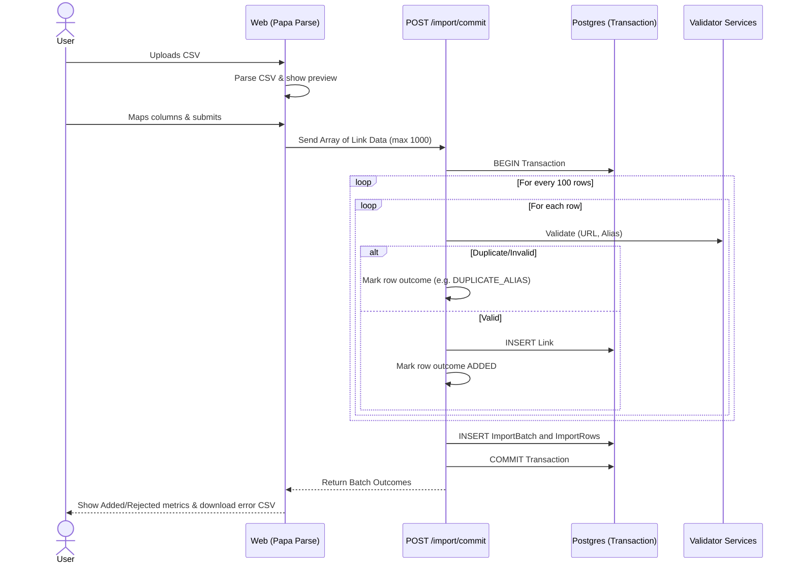

# Sequence Diagrams

## a) Create Link with Validation

## b) Redirect Happy Path with Async Logging

## c) Password-Protected Redirect

## d) Admin Disable & Cache Invalidation

## e) CSV Import

