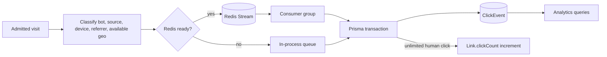

# Analytics Queries and Data Integrity

> **TECHNICAL REFERENCE | ANALYTICS AND DATA INTEGRITY**

## Contents

- [Data flow](#data-flow)
- [Metric behavior](#metric-behavior)
- [Indexes and access patterns](#indexes-and-access-patterns)
- [Known reporting limits](#known-reporting-limits)

## Data flow

The analytics API reads persisted `ClickEvent` records through Prisma. Events are enriched before persistence with source, bot classification, daily visitor hash, referrer channel, device/browser/OS, and available GeoIP fields. The Redis worker persists each event and any unlimited-link count update in a transaction; retries use the event UUID as the row ID. Without Redis, an in-process queue flushes events directly to PostgreSQL.

## Metric behavior

| Metric | Data behavior |
|---|---|
| Human clicks | `ClickEvent` rows where `isBot = false`. |
| Bot clicks | Rows where `isBot = true`; available for separate admin or analytics views where requested. |
| Unique visitors | Distinct `visitorHash` values in the selected range. The hash includes the UTC date, so it is a daily approximate identity. |
| Link click count | Human visits only. Limited-link admission increments atomically; unlimited-link increments occur with successful event persistence. |
| Time series | UTC calendar-date grouping with missing dates filled as zero in the response. |
| Geo summaries | Based on local `geoip-lite` data; private/local addresses and unknown locations may have no result. |

Filter semantics and available chart definitions are maintained in [`docs/design/06-analytics-metric-definitions.md`](../design/06-analytics-metric-definitions.md). Refer to the implementation when product definitions and runtime behavior differ.

## Indexes and access patterns

The Prisma schema currently declares these `ClickEvent` indexes:

| Index | Intended access pattern |
|---|---|
| `(linkId, occurredAt)` | Per-link events over a time range. |
| `(occurredAt)` | Time-window scans across the platform. |
| `(linkId, isBot, occurredAt)` | Per-link analytics filtered by bot status and time. |

Other relevant constraints include unique `Link.alias`, unique `BlockedDomain.domain`, and per-owner unique campaign/tag names. Index effectiveness depends on actual query plans and data distribution; validate with PostgreSQL `EXPLAIN (ANALYZE, BUFFERS)` before adding indexes.

## Known reporting limits

- UTC buckets are used even though `User.timezone` is stored.
- `visitorHash` rotates daily and is not a person-level identifier.
- GeoIP coverage depends on the local database and cannot resolve private/local IP addresses.
- The no-Redis queue is in process memory; an unexpected process stop can lose events that have not flushed.
- Analytics represent persisted events; newly queued events may take time to appear.
